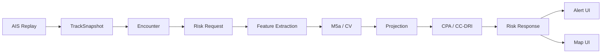
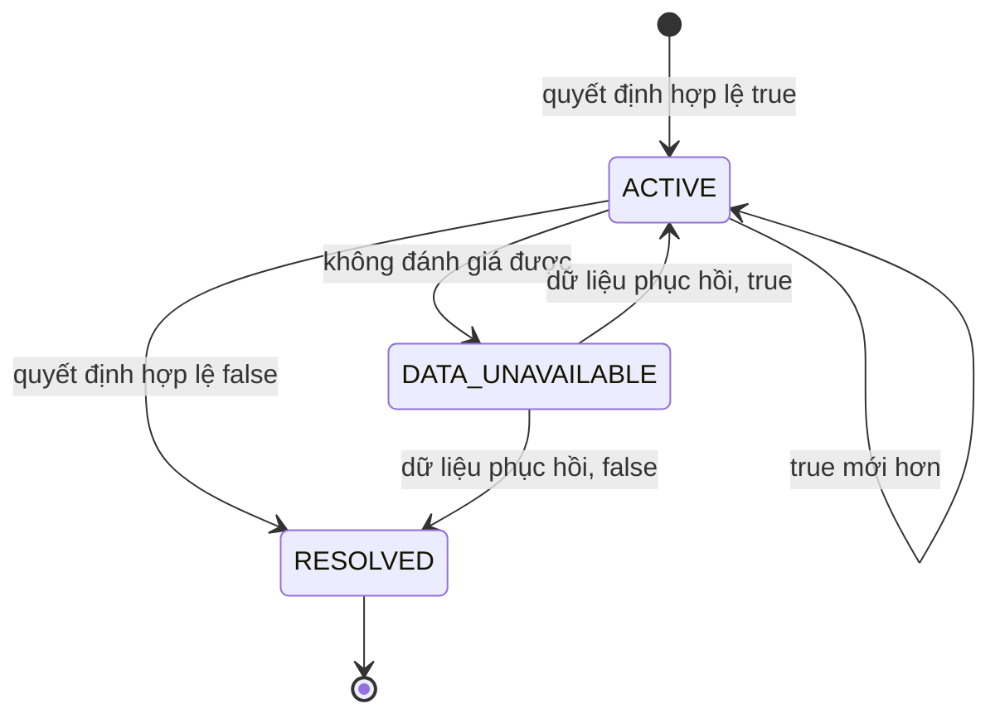

# Hợp đồng tích hợp Track, Encounter, Risk và Alert

Thiết kế Contract V1 được Trung phê duyệt ngày 2026-11-22; chưa có bằng chứng Toàn phê duyệt. Schema và runtime chưa được khóa triển khai. Xem `docs/contracts/CONTRACT_V1_DECISION_RECORD.md` và `docs/contracts/CONTRACT_V1_SPECIFICATION_GAPS.md`. Các file `.schema.json` là JSON Schema Draft 2020-12; `api_contract.yaml` là OpenAPI 3.1. Các ràng buộc dưới đây là đặc tả, chưa có runtime production.

## Trách nhiệm và luồng dữ liệu

Toàn cung cấp AIS replay, replay clock/session, TrackSnapshot gồm history LAT/LON/SOG/COG, timestamp lưới và nguồn, chất lượng track, ứng viên cặp, map và replay UI. Trung sở hữu xây dựng **Encounter từ candidate/snapshot**, xác định common EN origin, feature và Rule adapter, inference M5a/CV, projection, CPA/CC-DRI, Risk Response, alert state, risk API và risk/alert UI. Quy ước origin và mapping là giao diện chung; không mặc định Toàn sẽ triển khai lại chúng.

## Quy ước chung

- Timestamp dùng RFC 3339 UTC `Z` hoặc `+00:00`. Anchor là thời gian replay đánh giá; `evaluated_at` nếu có là thời gian xử lý server và không điều khiển vòng đời alert.
- `source_type` là phân loại hợp đồng, không phải label: `yang_lei`/`yanglei` → `YANG_LEI`, `real_ais_kattegat_v3` → `REAL_AIS`, `augmented_real_ais_kattegat_v3` → `SYNTHETIC_AIS`; các nguồn Test dùng ánh xạ theo loại, không đổi tên dữ liệu đã khóa.
- Real AIS và Synthetic AIS time-shift chọn bản tin as-of trên cùng trục thời gian áp dụng: `0 ≤ grid−source ≤ 60 s`. Real dùng original source; Synthetic dùng simulated source sau shift, original chỉ là provenance. Yang Lei dùng thời gian mô phỏng, không giả timestamp AIS.
- Canonical vessel ID chuẩn hóa Unicode NFC; hai ID phải khác nhau sau NFC, có namespace hợp lệ và nguồn ổn định; `physical_mmsi:` chỉ cho MMSI vật lý đã xác minh gồm chín chữ số. Sort hai canonical ID theo bytes UTF-8 tăng dần, serialize JSON array compact với Unicode thông thường không ASCII-escape và escape JSON chuẩn, hash SHA-256 bytes UTF-8 rồi thêm `pair:v1:` và hex thường. Online A là ID nhỏ hơn theo bytes, B là ID còn lại; không phụ thuộc thứ tự bản tin. Offline giữ A/B theo tensor index và không đổi mapping khi tính pair ID. Namespace đã duyệt là `simulated:<dataset>:<stable-id>`; tính ổn định và nguồn của dataset/stable ID vẫn cần xác minh, không dùng filename hoặc row index khi chưa chứng minh ổn định.
- Encounter replay có `enc:v1:` cộng SHA-256 hex thường của UTF-8 compact JSON `[session_id,pair_id,anchor_utc]`, trong đó session là UUID hợp lệ, pair ID hợp lệ và anchor UTC chính xác đến giây ở dạng `YYYY-MM-DDTHH:MM:SSZ`. Từ chối anchor precision dưới giây thay vì cắt/làm tròn. Cùng session/pair/anchor tạo cùng ID; thay bất kỳ thành phần nào tạo ID khác trong vector kiểm thử. Session ID production phải là UUID canonical chữ thường, có dấu gạch nối; snapshot ID là UUID opaque theo cùng định dạng. ID mock legacy không tự trở thành UUID production.
- Common EN lấy gốc tàu A tại t0−9, không phải anchor; sử dụng công thức trong `coordinate_contract.md`. Mỗi tàu có anchor riêng. LAT/LON trả `[latitude, longitude]`; forecast t0+1…t0+15. Không hiển thị tọa độ mô phỏng như vị trí AIS thật.
- `VALID`, `INSUFFICIENT_DATA`, `STALE`, `INVALID_DATA`, `OUT_OF_SCOPE` mô tả dữ liệu độc lập với inference, forecast, calibration và decision. `alert_triggered=null` là chưa có quyết định, không phải an toàn. Chỉ phát quyết định khi threshold đã calibration cho active model.
- Input thiếu/sai không được fallback. CV fallback chỉ cho lỗi kỹ thuật M5a khi input hợp lệ, trong miền áp dụng và CV hợp lệ; threshold CV riêng cần calibration. CV yêu cầu trực tiếp khác với CV fallback. Chưa calibration không tự tạo fallback.
- `OUT_OF_SCOPE` chỉ được quyết định theo phạm vi triển khai đã thống nhất sau này; các bộ lọc candidate trong benchmark không tự động là ngưỡng áp dụng cho demo. Chưa đặt ngưỡng khoảng cách hay tốc độ demo mới ở bước này.

## Request, response và ngữ nghĩa bổ sung

`POST /api/v1/risk/evaluate` nhận đúng một snapshot encounter đầy đủ; frontend không gửi tensor, threshold, weights hay thông tin future/ground truth. Backend dự kiến tạo `X_unscaled [2,10,4] float32`, SOG/COG `[2,10,2] float64`, anchor EN `[2,2] float64`, mapping A/B, anchor, 10 timestamp và origin. Kết quả hợp lệ về cấu trúc nhưng thiếu history có thể trả HTTP 200 với trạng thái nghiệp vụ, không chạy inference. Schema sai hoặc semantic invalid trả 422; 400 dành cho request không thể diễn giải; 404 không tìm thấy; 500 lỗi không dự kiến; 503 chỉ khi dịch vụ thật sự không khả dụng.

JSON Schema kiểm tra type, shape và một số điều kiện, còn runtime tương lai phải kiểm tra: hai tàu khác nhau; cùng anchor/session; thứ tự và đúng 10 mốc khi valid; current state bằng history cuối; source không sau grid và không stale; pair hash và A/B đúng với nguồn; origin đúng tàu A t0−9; forecast timestamps bằng anchor +1…+15; dữ liệu hữu hạn, không NaN/Infinity; cùng frame/đơn vị; và `risk_score = 0.68*predicted + 0.12*current + 0.20*rule` với tolerance số học được công bố khi triển khai. Thiếu component thì risk score null, không chuẩn hóa lại trọng số. Khi quyết định hợp lệ: `alert_triggered = (risk_score >= threshold)`; threshold phải đúng active model và version calibration. Không có các điều kiện đó thì decision null.

### CPA near-zero convention

Với input hợp lệ và `dot(v_rel,v_rel) ≤ 1e-9 kn²`, quy ước tính nội bộ đặt raw và clipped TCPA bằng 0 phút; DCPA bằng khoảng cách hiện tại và Current-CPA score vẫn hữu hạn. API trả `current_tcpa_minutes` và `current_tcpa_clipped_minutes` bằng `null`, trạng thái `UNDEFINED_LOW_RELATIVE_VELOCITY`, nhưng vẫn trả DCPA và Current score; CC-DRI vẫn tính khi các component khác hợp lệ. Đây là cách trình bày TCPA, không phải lỗi dữ liệu, không tự kích hoạt fallback và không tự ngăn alert khi đã calibration. Chưa calibration vẫn không đưa ra quyết định cảnh báo. Frontend hiển thị TCPA không xác định và không tự tính lại risk score từ trường null. Khi không near-zero, API trả TCPA raw và clipped riêng; raw âm là hợp lệ. `UNAVAILABLE` hoặc input invalid là trường hợp khác, không có risk score.

Predicted CPA tìm min tại các phút +1…+15, không bao gồm anchor. Không có geographic forecast không ngăn risk dùng common EN hợp lệ.

`requested_model`/`active_model`, `data_status`, `inference_status`, `calibration_status`, forecast và decision là các trạng thái độc lập. M5a có thể chưa có artifact; không tuyên bố model ready. Threshold cũ 0.420/0.435 chỉ tham khảo. Cả threshold và decision là null khi chưa calibration; score hợp lệ vẫn có thể được cung cấp để chẩn đoán.

## Alert, idempotency và replay

Một phiên replay có không quá một alert chưa RESOLVED cho cùng pair. `POST evaluate` dự kiến lưu evaluation và cập nhật alert một cách nguyên tử theo session/pair; `request_id` là idempotency key trong session. Khi `replay_session_id=null`, dùng namespace live được gắn kiểu riêng, không trùng bất kỳ namespace replay nào. Cùng key và payload trả kết quả đã lưu; cùng key nhưng payload khác là xung đột HTTP 409. Cùng encounter/anchor/model/snapshot với request ID khác được deduplicate; nếu dữ liệu snapshot khác tại cùng encounter ID, từ chối 409 và yêu cầu encounter ID mới. Evaluation cũ hơn `latest_evaluation_timestamp` có thể lưu lịch sử nhưng không đảo ngược alert state; evaluation trùng không tạo hoặc cập nhật alert lần hai. Điều kiện race phải được thực thi nguyên tử ở runtime, chưa được kiểm thử ở đây.

Không có alert mở và chưa đánh giá được thì không tạo alert. Sau RESOLVED, lần true mới tạo alert ID mới. DATA_UNAVAILABLE không phải RESOLVED; các giá trị được giữ phải đánh dấu `values_are_last_valid=true` và `values_as_of` tương ứng, không giả là evaluation mới. Play/pause/resume giữ session; pause/resume không tự tạo quyết định mới. Reset và mọi seek, tiến hoặc lùi, tạo **replay_session_id mới** và state namespace mới; RESET đưa session mới về READY/time=start, SEEK về PAUSED/time=target. Session states READY/PLAYING/PAUSED/ENDED/EXPIRED. `Idempotency-Key` bắt buộc cho RESET/SEEK, scope theo source session, cùng key/payload trả cùng kết quả, payload khác conflict 409, lưu tối thiểu 24 giờ. Control yêu cầu expected_version; mismatch 409, thay đổi thành công tăng version. Source session sau chuyển giao không cập nhật timeline mới; evaluation cũ không sửa alert session mới. End-of-timeline là ENDED, không giả rằng rủi ro đã giảm. Không có cooldown, hysteresis hay severity tùy ý.

## Phối hợp và versioning

V1 chọn REST session resource và polling; năm path được liệt kê trong OpenAPI. Session UUID và snapshot UUID là lowercase có gạch nối; session mới version 0. Control đổi trạng thái cùng session tăng version; RESET/SEEK tạo session mới version 0, source kết thúc và không điều khiển timeline hiện hành. Khi source đổi sang ENDED, version của source tăng 1 theo quy tắc đổi trạng thái cùng session. Session mới là session_id được trả trong control response; source ENDED không tự resolve alert. Track list cô lập session và snapshot bất biến: limit mặc định 50, từ 1–100; offset mặc định 0, không âm; trang sau truyền snapshot_id; TTL 5 phút, hết hạn 410. Create yêu cầu source_id; start_time tùy chọn, thiếu thì lấy đầu nguồn, không dùng wall-clock. Risk/alert T02 dùng profile V1 khi replay, tiếp tục cho live null session theo schema T02. Profile `encounter_v1.schema.json`/`replay.schema.json` tách production khỏi fixture legacy; kiểm tra semantic ở runtime vẫn bắt buộc.

Canonical control payload sau validation dùng JSON compact UTF-8 theo thứ tự key `action`, `target_time` (chỉ SEEK), `expected_version`; target được chuẩn hóa UTC `Z` không làm mất precision. Non-SEEK cấm target_time kể cả null. Retry cùng `Idempotency-Key`/canonical payload được tra trước version, trả kết quả đã ghi; khác payload trả 409. Key dài 1–128 ký tự, scope session nguồn, lưu tối thiểu 24 giờ tính từ lần đầu xử lý và ghi nhận kết quả. Version mismatch 409. Dữ liệu và key phải được ghi atomically trong implementation; ví dụ test không chứng minh runtime.

`is_simulated` mô tả provenance quỹ đạo, không quyết định tàu là physical hay simulated. `SYNTHETIC_AIS`/`YANG_LEI` có trajectory simulated; `REAL_AIS` không simulated. Synthetic trajectory có thể giữ `physical_mmsi:123456789` cùng `mmsi=123456789`. Physical ID phải khớp MMSI; simulated identity không mang MMSI physical khi chưa có quy tắc provenance được duyệt. Sự khớp này không chứng minh MMSI thực sự thuộc tàu ngoài đời; xác minh nguồn vẫn pending.

**PRODUCTION_V1 = structural schema hợp lệ VÀ semantic hợp lệ.** Consumer production bắt buộc chạy cả `replay.schema.json#/$defs/production_track` và `src.data.track_semantics.validate_track_semantics(..., profile='PRODUCTION_V1')` cho mỗi track, hoặc triển khai tương đương dùng vector `contracts/validation_vectors/g11_track_v1.json`. `validate_production_track_g11` là reference Python chạy hai tầng trong phạm vi G11; JSON Schema thuần không so sánh trực tiếp `vessel_id` và `mmsi`. Ngoài G11, runtime vẫn phải kiểm tra history, timestamps, hash, session và các invariant còn lại. `LEGACY_MOCK` dùng schema/validation legacy riêng và không tự trở thành production-valid. Pydantic T04 gọi cùng semantic rule với profile `LEGACY_MOCK`; parity được đánh giá ở cấp combined validation cho các case cùng profile/phạm vi, không yêu cầu JSON Schema structural từ chối lỗi semantic.

### Ma trận control được Trung duyệt

| Source | PLAY | PAUSE | RESUME | RESET | SEEK |
|---|---|---|---|---|---|
| READY | PLAYING | 409 | 409 | READY mới | PAUSED mới |
| PLAYING | 409 | PAUSED | 409 | READY mới | PAUSED mới |
| PAUSED | PLAYING | 409 | PLAYING | READY mới | PAUSED mới |
| ENDED | 409 | 409 | 409 | 409 | 409 |
| EXPIRED | 410 | 410 | 410 | 410 | 410 |

Control cùng session hợp lệ tăng version một lần. RESET/SEEK hợp lệ: kiểm tra/ghi atomic version, state source ENDED và version source +1, tạo session ID mới version 0 tại start/target, lưu kết quả key; retry cùng key/payload trả kết quả đã lưu trước khi xét version hay ENDED. SEEK thiếu target hoặc ngoài miền source trả 422, không ngầm replay khoảng bỏ qua. Sau chuyển giao source không điều khiển timeline mới; muốn phát lại sau ENDED phải POST create session. Auto-end PLAYING→ENDED không resolve alert. Concurrent control cùng expected_version: không quá một control thay đổi state thành công. Đây là yêu cầu contract, chưa phải runtime đã kiểm chứng.
