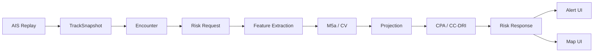
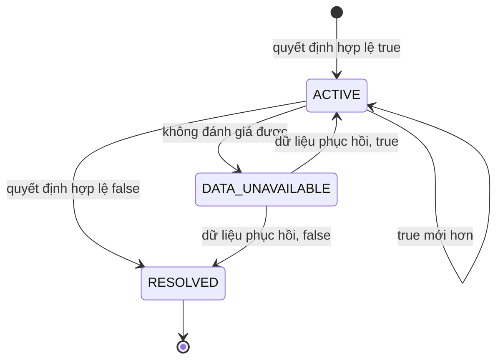

# Hợp đồng tích hợp Track, Encounter, Risk và Alert

Phiên bản thiết kế **1.0.0**, trạng thái **chờ review bản schema**. Trung và Toàn đã đồng ý phương án nghiệp vụ theo yêu cầu; chưa xác nhận từng schema cuối cùng hay khóa contract. Các file `.schema.json` là JSON Schema Draft 2020-12; `api_contract.yaml` là OpenAPI 3.1. Các ràng buộc dưới đây là đặc tả, chưa có runtime production.

## Trách nhiệm và luồng dữ liệu

Toàn cung cấp AIS replay, replay clock/session, TrackSnapshot gồm history LAT/LON/SOG/COG, timestamp lưới và nguồn, chất lượng track, ứng viên cặp, map và replay UI. Trung sở hữu xây dựng **Encounter từ candidate/snapshot**, xác định common EN origin, feature và Rule adapter, inference M5a/CV, projection, CPA/CC-DRI, Risk Response, alert state, risk API và risk/alert UI. Quy ước origin và mapping là giao diện chung; không mặc định Toàn sẽ triển khai lại chúng.

## Quy ước chung

- Timestamp dùng RFC 3339 UTC `Z` hoặc `+00:00`. Anchor là thời gian replay đánh giá; `evaluated_at` nếu có là thời gian xử lý server và không điều khiển vòng đời alert.
- `source_type` là phân loại hợp đồng, không phải label: `yang_lei`/`yanglei` → `YANG_LEI`, `real_ais_kattegat_v3` → `REAL_AIS`, `augmented_real_ais_kattegat_v3` → `SYNTHETIC_AIS`; các nguồn Test dùng ánh xạ theo loại, không đổi tên dữ liệu đã khóa.
- Real AIS và Synthetic AIS time-shift chọn bản tin as-of trên cùng trục thời gian áp dụng: `0 ≤ grid−source ≤ 60 s`. Real dùng original source; Synthetic dùng simulated source sau shift, original chỉ là provenance. Yang Lei dùng thời gian mô phỏng, không giả timestamp AIS.
- Offline giữ encounter ID và A/B theo tensor index đã khóa. Replay dùng vessel ID có namespace; `pair_id = 'pair:v1:' + SHA256(UTF-8(JSON compact mảng hai ID đã sắp xếp từ điển, ensure_ascii=false))`. Với hai MMSI thật 9 chữ số và cùng namespace `physical_mmsi:`, thứ tự từ điển giữ thứ tự số MMSI. Không áp quy tắc replay để sắp xếp lại offline. Hai ID phải khác nhau.
- Pair là định danh cặp ổn định; encounter là định danh **lần đánh giá** riêng. Replay service phải cấp encounter ID duy nhất toàn cục theo session, pair và anchor; lặp cùng evaluation dùng cùng encounter ID. Không tự giả định ID offline có thể tái sử dụng trong session khác.
- Common EN lấy gốc tàu A tại t0−9, không phải anchor; sử dụng công thức trong `coordinate_contract.md`. Mỗi tàu có anchor riêng. LAT/LON trả `[latitude, longitude]`; forecast t0+1…t0+15. Không hiển thị tọa độ mô phỏng như vị trí AIS thật.
- `VALID`, `INSUFFICIENT_DATA`, `STALE`, `INVALID_DATA`, `OUT_OF_SCOPE` mô tả dữ liệu độc lập với inference, forecast, calibration và decision. `alert_triggered=null` là chưa có quyết định, không phải an toàn. Chỉ phát quyết định khi threshold đã calibration cho active model.
- Input thiếu/sai không được fallback. CV fallback chỉ cho lỗi kỹ thuật M5a khi input hợp lệ, trong miền áp dụng và CV hợp lệ; threshold CV riêng cần calibration. CV yêu cầu trực tiếp khác với CV fallback. Chưa calibration không tự tạo fallback.
- `OUT_OF_SCOPE` chỉ được quyết định theo phạm vi triển khai đã thống nhất sau này; các bộ lọc candidate trong benchmark không tự động là ngưỡng áp dụng cho demo. Chưa đặt ngưỡng khoảng cách hay tốc độ demo mới ở bước này.

## Request, response và ngữ nghĩa bổ sung

`POST /api/v1/risk/evaluate` nhận đúng một snapshot encounter đầy đủ; frontend không gửi tensor, threshold, weights hay thông tin future/ground truth. Backend dự kiến tạo `X_unscaled [2,10,4] float32`, SOG/COG `[2,10,2] float64`, anchor EN `[2,2] float64`, mapping A/B, anchor, 10 timestamp và origin. Kết quả hợp lệ về cấu trúc nhưng thiếu history có thể trả HTTP 200 với trạng thái nghiệp vụ, không chạy inference. Schema sai hoặc semantic invalid trả 422; 400 dành cho request không thể diễn giải; 404 không tìm thấy; 500 lỗi không dự kiến; 503 chỉ khi dịch vụ thật sự không khả dụng.

JSON Schema kiểm tra type, shape và một số điều kiện, còn runtime tương lai phải kiểm tra: hai tàu khác nhau; cùng anchor/session; thứ tự và đúng 10 mốc khi valid; current state bằng history cuối; source không sau grid và không stale; pair hash và A/B đúng với nguồn; origin đúng tàu A t0−9; forecast timestamps bằng anchor +1…+15; dữ liệu hữu hạn, không NaN/Infinity; cùng frame/đơn vị; và `risk_score = 0.68*predicted + 0.12*current + 0.20*rule` với tolerance số học được công bố khi triển khai. Thiếu component thì risk score null, không chuẩn hóa lại trọng số. Khi quyết định hợp lệ: `alert_triggered = (risk_score >= threshold)`; threshold phải đúng active model và version calibration. Không có các điều kiện đó thì decision null.

### CPA near-zero convention

Với input hợp lệ và `dot(v_rel,v_rel) ≤ 1e-9 kn²`, quy ước tính nội bộ đặt raw và clipped TCPA bằng 0 phút; DCPA bằng khoảng cách hiện tại và Current-CPA score vẫn hữu hạn. API trả `current_tcpa_minutes` và `current_tcpa_clipped_minutes` bằng `null`, trạng thái `UNDEFINED_LOW_RELATIVE_VELOCITY`, nhưng vẫn trả DCPA và Current score; CC-DRI vẫn tính khi các component khác hợp lệ. Đây là cách trình bày TCPA, không phải lỗi dữ liệu, không tự kích hoạt fallback và không tự ngăn alert khi đã calibration. Chưa calibration vẫn không đưa ra quyết định cảnh báo. Frontend hiển thị TCPA không xác định và không tự tính lại risk score từ trường null. Khi không near-zero, API trả TCPA raw và clipped riêng; raw âm là hợp lệ. `UNAVAILABLE` hoặc input invalid là trường hợp khác, không có risk score.

Predicted CPA tìm min tại các phút +1…+15, không bao gồm anchor. Không có geographic forecast không ngăn risk dùng common EN hợp lệ.

`requested_model`/`active_model`, `data_status`, `inference_status`, `calibration_status`, forecast và decision là các trạng thái độc lập. M5a có thể chưa có artifact; không tuyên bố model ready. Threshold cũ 0.420/0.435 chỉ tham khảo. Cả threshold và decision là null khi chưa calibration; score hợp lệ vẫn có thể được cung cấp để chẩn đoán.

## Alert, idempotency và replay

Một phiên replay có không quá một alert chưa RESOLVED cho cùng pair. `POST evaluate` dự kiến lưu evaluation và cập nhật alert một cách nguyên tử theo session/pair; `request_id` là idempotency key trong session. Khi `replay_session_id=null`, dùng namespace live được gắn kiểu riêng, không trùng bất kỳ namespace replay nào. Cùng key và payload trả kết quả đã lưu; cùng key nhưng payload khác là xung đột HTTP 409. Cùng encounter/anchor/model/snapshot với request ID khác được deduplicate; nếu dữ liệu snapshot khác tại cùng encounter ID, từ chối 409 và yêu cầu encounter ID mới. Evaluation cũ hơn `latest_evaluation_timestamp` có thể lưu lịch sử nhưng không đảo ngược alert state; evaluation trùng không tạo hoặc cập nhật alert lần hai. Điều kiện race phải được thực thi nguyên tử ở runtime, chưa được kiểm thử ở đây.

Không có alert mở và chưa đánh giá được thì không tạo alert. Sau RESOLVED, lần true mới tạo alert ID mới. DATA_UNAVAILABLE không phải RESOLVED; các giá trị được giữ phải đánh dấu `values_are_last_valid=true` và `values_as_of` tương ứng, không giả là evaluation mới. Pause/resume giữ state và không tạo quyết định mới. Reset hoặc seek về quá khứ tạo **replay_session_id mới** và state namespace mới; session cũ được lưu trữ, không chuyển RESOLVED. Kết thúc session lưu trữ/đóng ngữ cảnh riêng với lý do kết thúc phiên, không giả rằng rủi ro đã giảm. Không có cooldown, hysteresis hay severity tùy ý.

## Phối hợp và versioning

Các endpoint replay/track của Toàn là dependency bên ngoài phạm vi OpenAPI này. Endpoint list phải lọc theo replay session khi client cung cấp session và sắp xếp ổn định như OpenAPI. Schema có `schema_version=1.0.0`; không tự đổi tên trường sau bàn giao. Breaking change phải thống nhất, ghi nhận, tăng phiên bản phù hợp và bổ sung test; không phát triển cùng schema theo hai hướng khác nhau. Chưa khóa cho đến khi hai thành viên review bản triển khai này.
