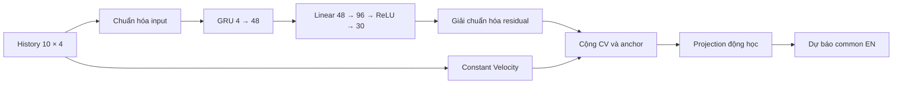

# Thiết kế Residual-GRU M5a

## Kiến trúc và dữ liệu

Input `[B,10,4]` theo thứ tự East, North tương đối anchor (nm), vận tốc East, North (knots); history từ −9 đến 0 phút. GRU một lớp, `batch_first`, hidden cuối, không dropout, có bias, một chiều; head cho output `[B,15,2]`. Khởi tạo PyTorch mặc định sau khi đặt seed. Tổng tham số: `3×48×(4+48+2) + (48×96+96) + (96×30+30) = 15.390`.

## Residual, scaler và tọa độ

Với k=1…15 phút: `CV(k)=v_anchor×k/60`; `R_true=Y_displacement−CV`, trong đó Y là vị trí tương lai trừ anchor riêng, không phải sai phân mỗi phút. Chỉ fit Train: reshape X thành `(-1,4)` và residual thành `(-1,2)`, fit StandardScaler độc lập theo từng kênh, cộng `1e-6` vào `scale_` sau fit; transform `(x−mean)/scale`, đổi `float32`, inverse `z×scale+mean`. Không sử dụng scaler cũ trong run mới.

Inference tham chiếu: giải chuẩn hóa residual, cộng CV displacement, cộng anchor riêng đúng một lần để vào common EN, rồi projection trên common EN. Projection là phép nhân quả: từ anchor và vận tốc anchor, mỗi bước lấy vận tốc mong muốn từ điểm raw trừ vị trí đã project trước đó; giới hạn tốc độ, độ đổi **vector** vận tốc, góc quay, rồi tích phân `v/60`. Cận lần lượt 49,999 kn, 2,999 kn/phút, 29,9°/phút; giới hạn góc chỉ khi hai tốc độ liên tiếp ≥3 kn. Mẫu chia được bảo vệ bởi `1e-12`.

QC riêng kiểm tra tốc độ >50 kn, thay đổi **độ lớn** tốc độ >3 kn/phút, góc >30°/phút khi cả hai tốc độ ≥3 kn, với tolerance `1e-9`. QC severe trong mã tham chiếu xét các cặp bước dự báo liên tiếp; chênh lệch tốc độ anchor–bước đầu chỉ là chẩn đoán khi được cung cấp, không thuộc severe flag. Projection không tự kiểm tra NaN/Inf; wrapper kiểm tra đầu vào, đầu ra và QC. Projection không chứng minh an toàn hàng hải; chuỗi phép chiếu tuần tự không được coi là bảo đảm tuyệt đối mọi ràng buộc cho mọi đầu vào bất thường.

## Huấn luyện và lựa chọn

AdamW, lr 0,0025, weight decay 0,0001, batch 256; seed 20261110–12; tối thiểu 25, tối đa 45 epoch, patience 8. Không dùng scheduler hay gradient clipping; xáo trộn Train bằng generator theo seed, `drop_last=False`, `num_workers=0`. Thực nghiệm tham chiếu chạy CPU, bật thuật toán xác định và đặt seed Python/NumPy/Torch; `auto/cpu/cuda` là lựa chọn mới cho repo, không đảm bảo tái lập số học giữa thiết bị.

Loss giảm trung bình trên phần tử: `MSE(R_scaled) + 0,15 MSE(P,P_true) + 0,02 MSE((V−V_true)/10) + 0,002 MSE((ΔV−ΔV_true)/3) + 0,001 K`, với `K=mean((relu(speed−50)/50)²)+mean((relu(|Δspeed|−3)/3)²)`. V tính từ displacement với gốc 0, nhân 60; ΔV xét các bước dự báo liên tiếp. Các thành phần vật lý được giải mã trong đồ thị gradient; không projection trong loss.

Mỗi epoch đánh giá Validation sau projection; chỉ lưu checkpoint QC severe bằng 0 và Real AIS ADE giảm hơn `1e-7 nm`. Stop sau tối thiểu 25 epoch nếu 8 epoch liên tiếp không cải thiện; tối đa 45. FDE được báo nhưng không là tie-break checkpoint. Best epoch và seed mới chưa xác định.

## CPA, risk và calibration

Current-CPA dùng `r=p_B−p_A`, `v=v_B−v_A`; `TCPA_raw=−(r·v)/(v·v)×60` phút nếu `v·v>1e-9`, ngược lại bằng 0; clip về [0,15] trước khi tính DCPA. Predicted-CPA lấy khoảng cách nhỏ nhất trong 15 điểm future common EN, không gồm anchor; thời gian là chỉ số nhỏ nhất đầu tiên +1 phút. Component dùng `sigmoid((0,65−d)/s)×(1−0,25×min(t,15)/15)`, với s=0,16 cho Current và 0,14 cho Predicted; đối số hàm mũ được clip [−100,100].

Với input hợp lệ và `v·v ≤ 1e-9 kn²`, hệ thống dùng raw/clipped TCPA nội bộ bằng 0, DCPA bằng khoảng cách hiện tại và vẫn tính Current score. API trả hai trường TCPA là `null` cùng trạng thái `UNDEFINED_LOW_RELATIVE_VELOCITY`, nhưng vẫn có DCPA và score. Backend dùng giá trị TCPA nội bộ để tính score trước khi chuyển thành JSON; frontend không tự tính lại score.

Rule chỉ dùng history: suy luận vai trò từ trung bình ba điểm đầu và tính biến thiên COG/SOG đầu–cuối; chi tiết các ngưỡng và thứ tự được ghi trong `risk_config.yaml`. Inference tham chiếu nhận thêm SOG/COG quan sát `[N,2,10,2]`; `EncounterDataset` hiện chưa trả trường này, nên tích hợp sau cần adapter history theo index, không giả định có thể khôi phục COG tin cậy từ vận tốc bằng 0. Nó là proxy, không phải phán quyết pháp lý COLREGs. `CC-DRI=0,68×Predicted-CPA+0,12×Current-CPA+0,20×Rule` là chỉ số, không phải xác suất va chạm.

Calibration và lựa chọn model là hai bước liên quan nhưng khác nhau: với từng ứng viên trên Validation, quét [0,1] bước 0,005, giữ recall ≥0,90, tối đa F1; hòa thì Real FPR thấp hơn, recall cao hơn, threshold thấp hơn. Sau đó áp dụng các điều kiện về QC, chất lượng dự báo và risk, rồi xếp seed theo thứ tự trong config. Một điều kiện so sánh Real ADE với mô hình GRU đối chứng của thực nghiệm trước (V1) đòi hỏi baseline có thể so sánh được; baseline mới chưa có, nên cần cung cấp baseline chạy mới hoặc quyết định protocol trước khi chọn model cuối, không tự lấy chỉ số cũ làm kết quả chính thức. Nếu không có candidate đủ điều kiện, dừng để xem xét; không chọn bằng Test. Alert dùng `score >= threshold` chỉ khi threshold của model tương ứng được calibration; 0,420 và 0,435 chỉ là lịch sử. Input thiếu/không hữu hạn trả insufficient data; fallback CV cho lỗi kỹ thuật phải có threshold calibration riêng trước khi phát alert chính thức.

## Đánh giá và giới hạn

Sau khi khóa model, scaler và threshold: ADE, FDE, Dmin MAE và QC theo nguồn; precision, recall, F1, ROC-AUC, FPR, confusion matrix, Real AIS FPR, Synthetic recall, dải Dmin và HARD negative. So sánh Current-CPA, CV-P-CPA, M5a-P-CPA và M5a + CC-DRI. Real chỉ có nhãn âm và Synthetic chỉ có nhãn dương nên không báo AUC riêng cho từng nhóm một nhãn. Test 1.320 encounter đã dùng trong nhiều vòng thực nghiệm trước (V1/V3/V4), là benchmark tái sử dụng, không phải holdout độc lập. Train chỉ mô phỏng, có domain shift và source–label confounding; các cặp phụ thuộc không độc lập. Chưa có đánh giá an toàn hàng hải thực tế.
